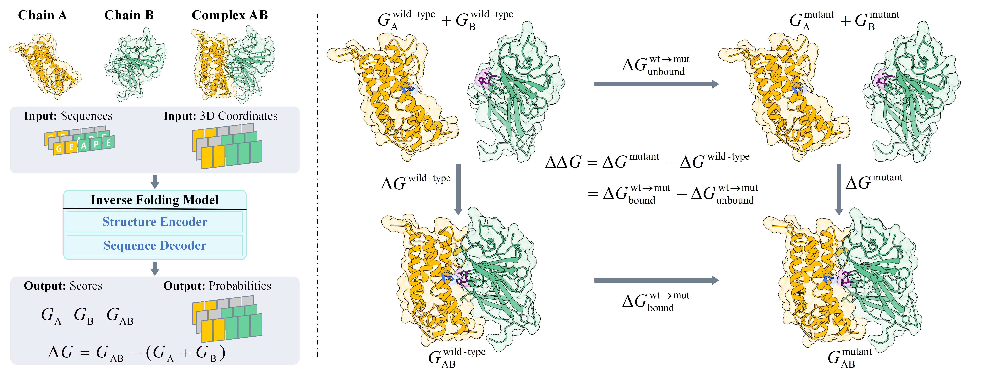

<div align="center">

# Boltzmann-Aligned Inverse Folding Model as a Predictor of Mutational Effects on Protein-Protein Interactions
[](https://arxiv.org/abs/2410.09543)
[](https://openreview.net/forum?id=lzdFImKK8w)



</div>


--------------------------------------------------------------------------------


The official implementation of our ICLR 2025 Spotlight paper "Boltzmann-Aligned Inverse Folding Model as a Predictor of Mutational Effects on Protein-Protein Interactions",
which establishes a bidirectional connection between log-likelihood in protein inverse folding models and $\Delta\Delta G$ values.


## Environment

### 1. Clone the repository
```shell
git clone https://github.com/aim-uofa/BA-DDG
cd BA-DDG
```

### 2. Prepare the environment

```shell
conda env create -f env.yml
conda activate BA-DDG
```


## Dataset

| Dataset   | Download Script                                    |
| --------- | -------------------------------------------------- |
| [SKEMPI v2](https://life.bsc.es/pid/skempi2) | [`data/get_skempi_v2.sh`](./data/get_skempi_v2.sh) |


## Usage
Download the trained weights from [Google Driver](https://drive.google.com/drive/folders/1We-D7XaixxWgWVJzF7suYpoaeaz1cV9w?usp=sharing) and put them into the ./ckpt folder. 

### Inference, BA-Cycle, unsupervised verison
Load the pre-trained ProteinMPNN model and make inference in an unsupervised setting.

```
cd training
python train_skempi.py --config_path ../config/inference_ba-cycle_skempi.json
```
You can choose different pre-trained ProteinMPNN weights by modifying the `ckpt_path` parameter in the config file. Available full protein backbone models include: vanilla_model_weights/v_48_002.pt, v_48_010.pt, v_48_020.pt, v_48_030.pt, and soluble_model_weights/v_48_002.pt, v_48_010.pt, v_48_020.pt, v_48_030.pt.

### Inference, BA-DDG, supervised version
Load the pre-trained BA-DDG model and make inference.
```
cd training
python train_skempi.py --config_path ../config/inference_ba-ddg_skempi.json
```

### Train, BA-DDG
You can set the wandb flag to use [Weights & Biases](https://wandb.ai/site).
```
cd training
python train_skempi.py --config_path ../config/train_ba-ddg_skempi.json --use_wandb
```

## Citation

```BibTeX
@article{jiao2024boltzmannaligned,
  title   = {Boltzmann-Aligned Inverse Folding Model as a Predictor of Mutational Effects on Protein-Protein Interactions},
  author  = {Xiaoran Jiao and Weian Mao and Wengong Jin and Peiyuan Yang and Hao Chen and Chunhua Shen},
  year    = {2024},
  journal = {arXiv preprint arXiv: 2410.09543},
  url     = {https://arxiv.org/abs/2410.09543v1},
  pdf     = {https://arxiv.org/pdf/2410.09543.pdf}
}
```


## Feedback
If you have any issue about this work, please feel free to contact [Xiaoran Jiao](mailto:xjiao@zju.edu.cn).

## License
For non-commercial academic use, this project is licensed under [the 2-clause BSD License](https://opensource.org/license/bsd-2-clause). 
For commercial use, please contact [Chunhua Shen](mailto:chhshen@gmail.com).
